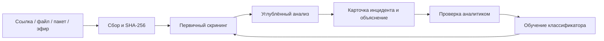

# AI Media Watch

**Мультимодальный анализ видео из социальных сетей для выявления признаков финансового мошенничества.**

Командный проект, разработанный в рамках **АФМ AI Hackathon 2026**, трек **AI Media Watch**. Хакатон проходил 24–25 июня 2026 года в Алматы, Farabi Hub. [Сайт и описание задания](https://www.qmahackaton.kz/).

Задача трека — сбор и анализ видео из Instagram, TikTok и других платформ: поиск признаков незаконного игорного бизнеса, финансовых пирамид и мошенничества, оценка риска и приоритизация материалов для проверки.

Проект помогает аналитику перейти от видео к структурированной карточке инцидента: сигналам риска, расшифровке, объяснению и связанным аккаунтам. Это хакатонный прототип; оценка риска требует проверки человеком. Измеренные показатели точности, скорости и промышленной надёжности в репозитории не заявлены.

## Возможности

- Загрузка видео по ссылке и загрузка локального файла; пакетный сбор и обработка папки.
- Мониторинг прямых эфиров короткими сегментами с формированием уведомлений.
- Первичный анализ кадров, OCR, аудио, метаданных, ключевых слов и платёжных идентификаторов.
- Углублённый анализ: Whisper, семантический анализ через LLM, поиск признаков поддельных скриншотов, сопоставление лиц и голосов.
- Карточки инцидентов, очередь аналитика, граф объяснения, связи между аккаунтами, география и тренды.
- SHA-256 исходного видео и журнал цепочки обработки материалов.
- Решения аналитика и обучение классификатора риска на подтверждённых примерах.
- Отдельный API для банков с аутентификацией по API-ключу.

Наличие интерфейса или модуля не гарантирует работу без его зависимостей. Для логотипов казино необходима специально обученная YOLO-модель; стандартная COCO-модель её не заменяет. Доступность загрузки и эфиров зависит от платформы, сети и cookies. Ошибки зависимостей сохраняются в результатах анализа; неполный анализ нужно учитывать при интерпретации риска.

## Как устроен проект



| Компонент | Технологии / назначение |
| --- | --- |
| Backend | Python 3.12, Django 5.1, Django REST Framework, JWT |
| Frontend | Next.js 16, React 18, TypeScript, Tailwind CSS, TanStack Query, Zustand |
| Хранилище и задачи | PostgreSQL 16, Redis 7, Celery |
| Видео и ML | yt-dlp, FFmpeg, OpenCV, Tesseract, Whisper, Ultralytics YOLO |
| LLM | OpenAI-совместимый endpoint либо Anthropic SDK |
| Графы и аналитика | vis-network, Recharts, Leaflet |

```text
accounts/       пользователи, роли и JWT
ingestion/      загрузка, пакеты и эфиры
screening/      первичный мультимодальный анализ
deepanalysis/   углублённый анализ и объяснения
incidents/      карточки, доказательства, графы и дашборд
learning/       словарь, аномалии и классификатор риска
bankapi/        внешние проверки по API-ключу
core/           общие модели, разрешения и LLM-клиент
ai_media_watch/ настройки Django и Celery
frontend/       веб-интерфейс
ml/             структура каталогов для датасетов
```

## Быстрый запуск через Docker

Потребуются Docker Engine и Docker Compose v2. Первая сборка тяжёлая: устанавливаются ML-библиотеки и dlib. Для загрузки моделей и обращения к LLM нужен доступ в интернет.

```bash
git clone https://github.com/song-ev/AFM-AI-Hackathon-2026-AI-Media-Watch.git
cd AFM-AI-Hackathon-2026-AI-Media-Watch
cp .env.example .env
# В PowerShell вместо cp: Copy-Item .env.example .env
```

В `.env` задайте `DJANGO_SECRET_KEY` и выберите LLM: заполните `LLM_API_KEY`, `LLM_BASE_URL`, `LLM_MODEL` либо `ANTHROPIC_API_KEY`, `ANTHROPIC_BASE_URL`, `ANTHROPIC_MODEL`. Ключи, внешние API-endpoint и имена моделей оставлены пустыми.

```bash
docker compose up --build -d
docker compose exec backend python manage.py create_demo_users
docker compose exec backend python manage.py seed_keyword_dictionary
```

| Адрес | Назначение |
| --- | --- |
| http://localhost:3000 | Веб-интерфейс |
| http://localhost:8000/api/health/ | Проверка доступности backend |
| http://localhost:8000/admin/ | Django Admin |

Для локальной демонстрации создаются `analyst_demo`, `lead_demo`, `bank_demo`, `admin_demo`; случайный пароль выводит команда. Команда также сбрасывает пароли существующих demo-пользователей и запрещена при `DEBUG=False`. Банковский API использует отдельный ключ:

```bash
docker compose exec backend python manage.py generate_bank_api_key bank_demo
```

Compose запускает backend, frontend, PostgreSQL, Redis, основной worker, отдельный worker очереди `live` и Celery beat для недельного обучения. Для проверки загрузите собственный тестовый ролик на странице анализа. Успешный health-check подтверждает доступность API, а не готовность всех AI-модулей.

```bash
docker compose logs -f backend worker
docker compose down
```

### Запуск без Docker

Рекомендуется Linux или WSL2: установка `face_recognition`/dlib требует компилятора и CMake. Нужны Python 3.12, Node.js 20.9+, PostgreSQL, Redis, FFmpeg, Tesseract (пакеты `eng`, `rus`, `kaz`) и Deno либо Node.js для yt-dlp.

```bash
python -m venv .venv
source .venv/bin/activate
# PowerShell: .\.venv\Scripts\Activate.ps1
python -m pip install --upgrade pip "setuptools<70" wheel
python -m pip install --no-build-isolation openai-whisper==20240930
python -m pip install -r requirements.txt
cp .env.example .env
# Настройте DATABASE_URL, Redis и LLM в .env
python manage.py migrate
python manage.py create_demo_users
python manage.py seed_keyword_dictionary
python manage.py runserver
```

В отдельных терминалах с активным окружением:

```bash
celery -A ai_media_watch worker -l info
celery -A ai_media_watch worker -Q live -l info --pool=solo -n live@%h
celery -A ai_media_watch beat -l info
```

Для Windows используйте `--pool=solo` и для основного worker. `CELERY_TASK_ALWAYS_EAGER=True` позволяет синхронную обработку без Redis для коротких локальных демонстраций; эфиры требуют отдельного worker.

```bash
cd frontend
cp .env.example .env.local
npm ci
npm run dev
```

## Настройки AI и источников

| Переменные | Для чего |
| --- | --- |
| `LLM_API_KEY`, `LLM_BASE_URL`, `LLM_MODEL` | Основной OpenAI-совместимый LLM-провайдер |
| `ANTHROPIC_API_KEY`, `ANTHROPIC_BASE_URL`, `ANTHROPIC_MODEL` | Альтернативный провайдер, если основной ключ пуст |
| `WHISPER_STAGE1_MODEL`, `WHISPER_STAGE2_MODEL` | Размер моделей распознавания речи |
| `TESSERACT_CMD`, `TESSDATA_DIR` | OCR и языковые данные |
| `YOLO_MODEL_PATH`, `YOLO_LOGO_CLASSES` | Пользовательские веса и целевые классы логотипов |
| `YTDLP_COOKIES_FILE`, `YTDLP_PROXY` | Доступ к источникам и исходящий прокси |
| `YTDLP_JS_RUNTIMES`, `YTDLP_IMPERSONATE` | Поддержка загрузки через yt-dlp |

Веса моделей, cookies, исходные видео и результаты анализа не включены в публичную копию. Установите необходимые веса отдельно; путь внутри контейнера должен существовать. Для пользовательских моделей и cookies используйте read-only bind mount вне репозитория. Первый запуск Whisper/YOLO может скачать модели.

## Подключение собственных API

Данные команды для доступа к сервисам не распространяются. Каждый пользователь создаёт свои учётные записи и задаёт параметры локально:

1. Скопируйте `.env.example` в `.env`. У выбранного LLM-провайдера получите собственный API-ключ, базовый URL и точное имя доступной модели. Заполните все три поля `LLM_*` либо `ANTHROPIC_*`; приоритет имеет `LLM_API_KEY`. Без полного набора параметров LLM-анализ возвращает ошибку конфигурации и не обращается к провайдеру.
2. Настройте свой PostgreSQL (`DATABASE_URL`) и Redis (`CELERY_BROKER_URL`, `CELERY_RESULT_BACKEND`). Значения localhost и демонстрационные пароли в шаблонах предназначены для локального запуска. Для развёртывания замените их и `DJANGO_SECRET_KEY` собственными значениями.
3. Для загрузки с платформ при необходимости укажите собственный `YTDLP_COOKIES_FILE` и `YTDLP_PROXY`. Файлы cookies храните вне репозитория; в контейнер передавайте отдельным read-only mount.
4. Для frontend скопируйте `frontend/.env.example` в `frontend/.env.local`. `NEXT_PUBLIC_API_URL` — адрес вашего backend. При локальном Docker-запуске используется localhost:8000.
5. Карта не имеет преднастроенного сервера тайлов. При необходимости задайте `NEXT_PUBLIC_MAP_TILE_URL` (шаблон URL провайдера с `{z}`, `{x}`, `{y}`) и требуемую провайдером `NEXT_PUBLIC_MAP_ATTRIBUTION`. Без них отображаются маркеры без фоновой карты. Для Docker эти два значения задаются в корневом `.env`, для локального Next.js — в `frontend/.env.local`.

Все `NEXT_PUBLIC_*` попадают в браузерную сборку: не помещайте туда секретные API-ключи. После изменения этих параметров перезапустите dev-сервер или пересоберите frontend. Банковский ключ создаётся локально командой `generate_bank_api_key`; ключей из исходной системы в репозитории нет.

`.env`, cookies, ключи, базы данных, медиа и сборки исключены из публикации. В примерах и тестах используются искусственные данные. Ссылки на сайт хакатона, соцсети и общедоступные ресурсы зависимостей сохранены; они не содержат учётных данных команды.

## Основные API

| Метод и путь | Назначение |
| --- | --- |
| `POST /api/auth/login/` | Вход, выдача JWT |
| `GET /api/auth/me/` | Текущий пользователь |
| `POST /api/ingestion/videos/` | Загрузка по URL |
| `POST /api/ingestion/videos/upload/` | Загрузка файла |
| `GET /api/ingestion/videos/<id>/status/` | Статус обработки |
| `POST /api/ingestion/bulk/` | Пакетный сбор |
| `POST /api/ingestion/live/` | Запуск мониторинга эфира |
| `GET /api/incidents/` | Очередь инцидентов |
| `POST /api/bank/v1/risk-check/` | Проверка идентификатора получателя |
| `GET /api/bank/v1/health/` | Доступность банковского API |

Внутренний API: `Authorization: Bearer <access_token>`. Банковский API: `Authorization: ApiKey <bank_api_key>`. Банку возвращается ограниченная сводка риска без внутренних материалов расследования. В текущей реализации `IsAfmLeadOrAbove` допускает все внутренние роли, включая аналитика.

## Проверки

```bash
docker compose exec backend python manage.py check
docker compose exec backend python manage.py test --settings=ai_media_watch.settings.test
docker compose exec frontend npm run lint
docker compose exec frontend npm run typecheck
docker compose exec frontend npm run build
```

Без Docker: `python manage.py test --settings=ai_media_watch.settings.test`; в папке `frontend` — `npm run lint`, `npm run typecheck` и `npm run build`. Тестовый профиль использует SQLite в памяти, локальную очередь Celery и пустые API-ключи. Его нельзя использовать для развёртывания. Сборка frontend загружает Inter через Google Fonts и требует доступа к этому сервису.

Health-check и сборка интерфейса не заменяют проверку полного сценария на тестовом видео с настроенными моделями. Фактические результаты проверок — в [VALIDATION.md](VALIDATION.md), подготовка копии — в [PUBLICATION.md](PUBLICATION.md).

## Документация

- [TECH.md](TECH.md) — подробности архитектуры и алгоритмов.
- [PARSING.md](PARSING.md) — сбор видео и пакетная обработка.
- [LIVE.md](LIVE.md) — мониторинг эфиров.
- [PRODUCTION.md](PRODUCTION.md) — требования к развёртыванию backend.
- [PUBLICATION.md](PUBLICATION.md) — изменения для GitHub и команды публикации.

Дополнительные документы описывают разработку прототипа и могут содержать проектные предположения. Production Compose разворачивает backend без frontend и TLS-прокси; промышленное внедрение требует отдельной проверки безопасности, доступа к данным и качества моделей.

## Команда и права

Проект создан командой участника АФМ AI Hackathon 2026. Репозиторий не заявляет статус официального продукта АФМ.
